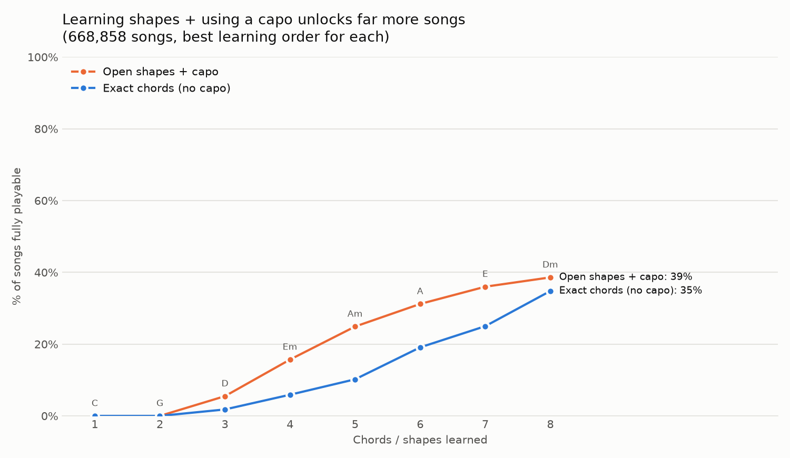
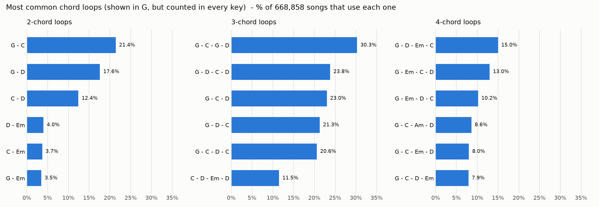

# Guitar Analytics: How Many Songs can you Actually Play?

I've played guitar for over 10 years, and one thing I noticed early on is that a ton of popular songs use the same handful of chord shapes. Most beginners don't figure that out until much later, so they end up learning chords in a random order and burning out before it pays off.

I wanted to test that with data. Using chord charts for **668,858 songs**, I looked at three questions:

1. If you learn chords in the smartest possible order, how many songs can you play after each one?
2. How much does a capo change that, since it lets the same shapes play songs in different keys?
3. Which chord patterns show up the most, and does that change by genre?

## Key findings

**With a capo, the same 4 beginner shapes unlock 2.7x more songs.**
G, C, D, and Em let you play 39,257 songs as written. Add a capo and that jumps to 105,344, with no new chords to learn. Most of the gain comes from capo on fret 5 (which plays songs in C without the F chord) and fret 7 (songs in D).



**Payoff is back-loaded, and barre chords are the big unlock.**
Your first 3 chords cover under 2% of songs, but 10 chords cover 64%. The biggest single jumps came from B (+17 points), E (+12), and Bm (+10). Open shapes alone top out around 39% of songs, so barre chords are what get you the rest of the way.

**The real backbone of popular music is 3 chords, not 4.**
The famous "4 chord song" loop (G – D – Em – C, in any key) is real: it appears in 100,417 songs, about 15% of the dataset. But the most common patterns overall are built from just G, C, and D. The top one, G – C – G – D, shows up in 30% of songs.



**Country is the most beginner-friendly genre.**
29% of country songs use *only* G, C, D, and Em (in some key), almost double pop at 15%. Metal sits at the other end: it uses the 4-chord loop as often as pop does, but only 7% of metal songs stick to just those chords.

## How it works

| Script | What it does |
|---|---|
| `chord_coverage.py` | Simplifies each chord (`Cmaj7` → `C`, `G/B` → `G`), then finds the learning order that unlocks the most songs at each step |
| `chord_capo.py` | Repeats the analysis using chord *shapes*, trying every capo position from fret 0 to 7. `--open-only` limits it to shapes beginners actually learn |
| `chord_progressions.py` | Detects each song's key, then counts repeating chord loops in a key-independent way. Results are shown in the key of G so they're easy to read and play |
| `practice_tracker.py` | Logs practice sessions and charts progress over time (minutes per week, chord changes per minute) |

**A note on the capo model.** My first version optimized purely for song count, and it told beginners to learn Bb, Eb, and Bbm shapes, which no guitar teacher would ever recommend. The math was right but the answer was useless. Limiting it to open shapes gave a realistic order (C, G, D, Em, Am, A, E, Dm) that matches how people actually learn.

**Limitations.** Chords are simplified to major or minor, so a song full of 7th chords counts the same as one without them. Key detection uses a simple rule (pick the key where the most chords fit), which can misread songs that change key. The data comes from user-submitted chord charts, so it reflects what people choose to tab, not a random sample of all music.

## Run it yourself

```
pip install -r requirements.txt
python chord_coverage.py
python chord_capo.py --open-only
python chord_progressions.py
```

The scripts expect `chordonomicon_v2.csv` in the same folder. It's too large for GitHub, so download it from the [Chordonomicon dataset page](https://huggingface.co/datasets/ailsntua/Chordonomicon) (Files tab).

## Data

Chord progressions from the **Chordonomicon** dataset (Kantarelis et al., 2024), which collects chord charts for roughly 680,000 songs along with genre and release information.

## What's next

- A dashboard that takes the shapes you already know and tells you which one to learn next, and how many songs it unlocks
- Tracking how chord complexity has changed by decade

---

Built by Abrar Ahmed · Finance, James Madison University
